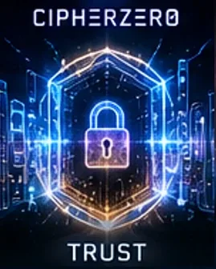

# CIPHΞRZER0

**A cryptographic trust plane. Key lifecycle, purpose-bound encryption, signed policy, scoped grants for workloads and AI agents, a hash-chained evidence log and post-quantum migration planning, under one governed model.**

[▶ Interactive demo](https://mdlc.ai/cipherzer0-demo.html) · [Build dossier](https://mdlcai.github.io/ai-mdlc-kernel-examples/cipherzero/index.html) · [Build with MDLC →](https://mdlc.ai)

> One of seventeen reference apps built end-to-end with the **[MDLC](https://mdlc.ai)** methodology, from a `RESEARCH.md` blueprint, through architecture and build, to a passing set of quality gates.

## What it does

A multi-tenant trust plane: a REST API and console in front of a trust-core service that holds the keys and talks gRPC over mTLS. It covers key rotation and two-person crypto-shred, envelope encryption with purpose-bound decrypt, signed policy bundles evaluated deny-by-default, short-lived scoped grants for AI agents, a hash-chained evidence log with signed Merkle checkpoints, APEX risk analysis, and quantum readiness: a crypto asset inventory, a customer-side scanner CLI, and clientless discovery of TLS endpoints on verified domains through an isolated prober.

The interactive demo is **read-only** and runs entirely in your browser on simulated data. It does not connect to a running CIPHΞRZER0, and nothing you do in it is saved. The numbers below come from the real build.

## Built from a blueprint

| Stage | Artifact | What it is |
|-------|----------|------------|
| 1 · Research | [`RESEARCH.md`](RESEARCH.md) | Product vision, workflows, threat model, GO decision |
| 2 · Architecture | [`ARCHITECTURE.md`](ARCHITECTURE.md) | System design and invariants, each tied to its proof |
| 3 · Contract | [`SPEC.md`](SPEC.md) · [`DECISIONS.md`](DECISIONS.md) | Screens, endpoints, and the ADRs behind them |
| 4 · Assurance | [`COMPLIANCE.md`](COMPLIANCE.md) · [`SECURITY-AUDIT.md`](SECURITY-AUDIT.md) | Control mapping and the security audit passes |
| 5 · Governance | [`GOVERNANCE-DECISIONS.jsonl`](GOVERNANCE-DECISIONS.jsonl) | Append-only decision records, including the human approvals |
| 6 · Build report | [`REPORT.md`](REPORT.md) | Every gate, every run, through the v0.5.2 ship |
| Evidence | [`evidence/`](evidence/) | Reviewer rounds 1 to 9 with two settle checks, and the security passes |

## The gates it passed

| Gate | Result |
|------|--------|
| Tests | 733 / 733 unit and integration tests at 0.5.2; first verification 271 / 271 with 91.48% line coverage |
| Smoke | 48 / 48 against the redeployed stack |
| Invariants | 59 / 59 machine-checked, 1 manual check left to the reviewer |
| Reviewer | Rounds 1, 2, 4, 5, 6 and 7 FAIL, each fixed (including a prober that could read the CA key); every settle check PASS |
| Security audit | PASS WITH ADVISORY. At ship: 0 critical, 0 high, 0 medium open; 11 low deferred with reasons |
| Web baseline | 226 failures to 0 over two fix batches; landing and dashboard Lighthouse performance below 80, accepted (ADR-071) |
| Design | 8 pass, 16 warn, 0 fail over 24 screens |
| Compliance | 94 implemented, 9 with a recorded residual, 0 gaps (a control mapping, not a certification) |

## Honest posture

- After 0.5.2 shipped, a full-repository security review found 4 high and 1 medium issue (SEC-40 to SEC-44). Fixes are written but not yet committed or through the ship gates.
- Lighthouse performance on the landing and dashboard pages sits below 80, accepted under ADR-071.
- The 1,000 virtual-user load profile is scripted, but only the k6 smoke profile's result is recorded.
- HSTS is absent on the localhost edge under the local CA (ADR-017).

The [build dossier](https://mdlcai.github.io/ai-mdlc-kernel-examples/cipherzero/index.html) has the full gate history and every open item.

## Stack

Next.js 16 console, Express 5 REST API, a gRPC trust-core over mTLS (AES-GCM with hybrid ML-KEM and ML-DSA), BullMQ worker, an isolated egress prober, Prisma 7 on PostgreSQL (primary and replica), Redis, Prometheus and Grafana, behind Caddy in Docker Compose. Playwright end-to-end on desktop Chrome and Pixel 7.
