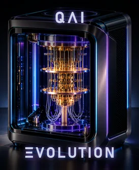

# QAI // ΞVOLUTION

**A quantum circuit SDK and multi-tenant platform. Its Evolution Engine adopts a new QAOA configuration only when independent validation passes and the score improves by a set margin.**

[▶ Open the Evolution Engine](https://quantum.mdlc.ai/app/optimization) · [Build dossier](https://mdlcai.github.io/ai-mdlc-kernel-examples/qai-evolution/index.html) · [Build with MDLC →](https://mdlc.ai)

> One of seventeen reference apps built end-to-end with the **[MDLC](https://mdlc.ai)** methodology, from a `RESEARCH.md` blueprint, through architecture and build, to a passing set of quality gates.

## What it does

QAI has two parts. The `qai` Python SDK does statevector simulation, circuit compilation, Grover and QAOA, and validation against Qiskit Aer as an independent reference. The multi-tenant web platform runs simulation, algorithm, validation, benchmark and evolution jobs, keeps sha256-verified evidence, and gates releases on that evidence.

The Evolution Engine is part of QAI. It perturbs a QAOA MaxCut configuration with a fixed seed, then scores each candidate on two measures: V (every seed's run passes validation) and J (mean of 1 minus the approximation ratio). A candidate is accepted only when V holds and J improves on the current checkpoint by at least ε. The server re-checks every decision against the SDK. Release 0.8.0 added a six-test evidence protocol, and the later Validation Lab work added classical baselines, ablations with Holm-corrected statistics and a report bundle. Every result is noiseless state-vector simulation on small instances; no quantum hardware is involved.

The demo at quantum.mdlc.ai is a **read-only copy** of the QAI web app on a Cloudflare Worker, answering from a frozen, invented dataset (a fictional lab). Starting an evolution run replays a recorded run and computes nothing; other changes are refused. The numbers below come from the real build, run against its full local stack.

## Built from a blueprint

| Stage | Artifact | What it is |
|-------|----------|------------|
| 1 · Research | [`RESEARCH.md`](RESEARCH.md) | Product vision, workflows, threat model, GO decision |
| 2 · Architecture | [`ARCHITECTURE.md`](ARCHITECTURE.md) | System design and invariants, each tied to its proof |
| 3 · Contract | [`SPEC.md`](SPEC.md) · [`DECISIONS.md`](DECISIONS.md) | Screens, endpoints, and the ADRs behind them |
| 4 · Assurance | [`COMPLIANCE.md`](COMPLIANCE.md) · [`evidence/security/`](evidence/security/) | Control mapping and the seven security passes |
| 5 · Governance | [`GOVERNANCE-DECISIONS.jsonl`](GOVERNANCE-DECISIONS.jsonl) | Hash-chained decision records, including the human approvals |
| 6 · Build report | [`REPORT.md`](REPORT.md) | Every gate and run through the 0.8.0 release |
| Evidence | [`evidence/`](evidence/) | Reviewer rounds 1 to 33 and security passes 1 to 7 |

## The gates it passed

Numbers are from the R9 ship (11 November 2026, commit `38e45fd`), built on release 0.8.0 and not yet versioned.

| Gate | Result |
|------|--------|
| Tests | SDK 623 passed (9 skipped), API integration 366 against real Postgres and Valkey, web unit 391, end-to-end 52 on desktop and mobile |
| Smoke | 29 / 29 |
| Invariants | 37 / 37 machine-checked, 1 manual check left to the reviewer; the web-baseline invariant passes with two cells accepted by ADR |
| Reviewer | 33 rounds; rounds 1, 17, 19, 30 and 31 FAIL, fixed (including a requeue that bypassed the one-protocol-per-tenant slot); round 33 PASS with conditions, met |
| Security audit | Pass 3 FAIL: 1 high (an unauthenticated regex backtracking stall in the log redactor), fixed at the root in pass 4. Now 0 critical, 0 high, 0 medium open; low and info items accepted with reasons |
| Frontend audit | 93 cells over 31 screens; only failures are HSTS on localhost (ADR-29) and mobile Lighthouse performance of 70 (landing) and 67 (app), accepted as host-bound (ADR-56); accessibility 100 |
| Compliance | 36 rows: 16 implemented, 20 with a residual or waiting on measurement, 0 gaps (last re-checked at re-entry R3) |

## Honest posture

- The last numbered release is 0.8.0. Re-entries R7 to R9 (Formula Lab notation and the Validation Lab) are shipped to the local stack but unreleased.
- The stack runs locally in Docker Compose. It is not publicly deployed; a remote host needs a public certificate, HSTS, real secrets, a Valkey password and backups.
- The "50k+ concurrent" scale target is not demonstrated (single host, ADR-09), and `/api/health` p95 was 618 ms against a 500 ms target on the Docker Desktop host.
- No dedicated security pass covered R5 to R9; those changes were checked in reviewer rounds only. No secret scanner or TypeScript SAST tool was available.
- All results are noiseless simulation on small instances (the protocol uses 6 to 10 nodes). No noisy simulator or hardware backend exists.

The [build dossier](https://mdlcai.github.io/ai-mdlc-kernel-examples/qai-evolution/index.html) has the full gate history and every open item.

## Stack

Python 3.14 SDK with NumPy and SciPy (Qiskit only in the reference extra). FastAPI 0.162, SQLAlchemy 2.1 async and Alembic, with a worker and scheduler. Next.js 16, React 19 and Tailwind 4. PostgreSQL 18 (primary and streaming replica) and Valkey, behind Caddy 2.11.7 in Docker Compose. Playwright end-to-end on desktop and mobile.
