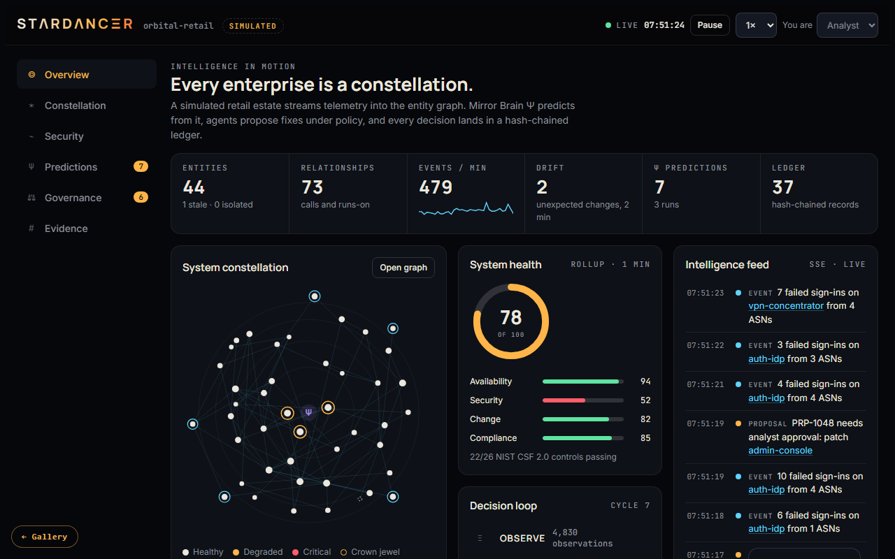

# STΛRDΛNCΞR

**A system intelligence platform. It reads what your observations mean together, and nothing it proposes happens until governance says it can.**

[▶ Interactive demo](https://mdlcai.github.io/ai-mdlc-kernel-examples/stardancer/demo.html) · [Build dossier](https://mdlcai.github.io/ai-mdlc-kernel-examples/stardancer/index.html) · [Build with MDLC →](https://mdlc.ai)

> One of thirteen reference apps built end-to-end with the **[MDLC](https://mdlc.ai)** methodology, from a `RESEARCH.md` blueprint, through architecture and build, to a passing set of quality gates. Nothing here was hand-tuned after generation.

## What it does

An estate streams telemetry into an entity graph of services, hosts and identities. STΛRDΛNCΞR rolls it up into health, security, change and compliance scores, predicts drift and risk from it, and lets agents propose fixes. A proposal waits for policy and, where the policy says so, a human approver before anything changes. Every decision is written to a SHA-256 hash-chained evidence ledger.

The interactive demo is **read-only** and runs entirely in your browser on a simulated 44-entity retail estate. It does not connect to a running STΛRDΛNCΞR, and nothing you do in it is saved. The numbers below come from the real build.

## Built from a blueprint

| Stage | Artifact | What it is |
|-------|----------|------------|
| 1 · Research | [`RESEARCH.md`](RESEARCH.md) | Product vision, workflows, threat model, GO decision (2026-10-12) |
| 2 · Architecture | [`ARCHITECTURE.md`](ARCHITECTURE.md) | System design and invariants, each tied to its proof |
| 3 · Contract | [`SPEC.md`](SPEC.md) · [`DECISIONS.md`](DECISIONS.md) | 33 screens, 89 endpoints, and the ADRs behind them |
| 4 · Assurance | [`COMPLIANCE.md`](COMPLIANCE.md) · [`SECURITY-AUDIT.md`](SECURITY-AUDIT.md) | Control mapping and the two-pass security audit |
| 5 · Governance | [`GOVERNANCE-DECISIONS.jsonl`](GOVERNANCE-DECISIONS.jsonl) | Append-only decision records, including the human approvals |
| 6 · Build report | [`REPORT.md`](REPORT.md) | Every gate, every run, through the v0.1.7 ship |

## The gates it passed

| Gate | Result |
|------|--------|
| Tests | 569 / 569 at release (server 217, web 345, shared 7) |
| Smoke | 52 / 52 automated flows at the release build |
| Invariants | 56 / 56 machine-checked, 1 manual check left to the reviewer |
| Reviewer | Round 1 FAIL on five items, fixed; rounds 2, 3 and 4 PASS |
| Security audit | Pass 1: 1 high, 3 medium, 6 low. After pass 2: 0 critical, 0 high, 0 medium, 7 low deferred with reasons |
| Performance | Halted the build at 72 / 71 against a floor of 80. Fixed by a speed pass, not by moving the floor: landing 91, overview 81 at v0.1.7 |
| Frontend audit | 99 / 99 cells; Lighthouse accessibility and best practices 100 |

## Honest posture

- Live Stripe billing was not verified (no keys in the build environment); the simulated billing mode is covered.
- Most load-test targets were missed on the 4-CPU build machine. Single requests are within target.
- Server statement coverage is about 87%; web is about 93%.

The [build dossier](https://mdlcai.github.io/ai-mdlc-kernel-examples/stardancer/index.html) has the full gate history and every open item.

## Stack

TypeScript end to end: Next.js 16 web, an Express API with shared zod DTOs, Prisma on PostgreSQL 17, Redis, server-sent events for live updates, Docker Compose behind Caddy, Playwright e2e on desktop and mobile.
