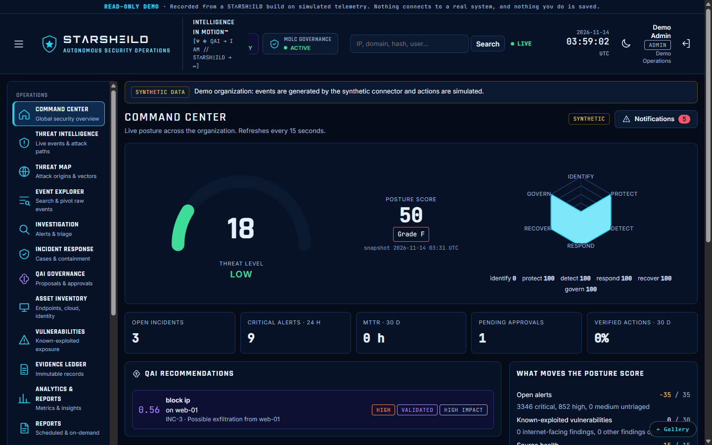

# STΛRSHΞILD

**A governed security operations console. It turns signed telemetry into alerts and incidents, and no response action runs until policy and a human approver say it can.**

[▶ Interactive demo](https://mdlcai.github.io/ai-mdlc-kernel-examples/starshield/demo.html) · [Build dossier](https://mdlcai.github.io/ai-mdlc-kernel-examples/starshield/index.html) · [Build with MDLC →](https://mdlc.ai)

> One of fifteen reference apps built end-to-end with the **[MDLC](https://mdlc.ai)** methodology, from a `RESEARCH.md` blueprint, through architecture and build, to a passing set of quality gates. Nothing here was hand-tuned after generation.

## What it does

Endpoint, identity, network, cloud and vulnerability sources post signed events to STΛRSHΞILD. It correlates them into alerts and incidents linked to assets, scores and triages them, and keeps SLA timers running. A copilot suggests next steps, and a deterministic engine ranks bounded response proposals. Response actions are proposals: they pass a policy check and human approval before anything runs, and a high-impact action needs two approvers, neither of them the proposer, and every change is written to a hash-chained evidence ledger.

The interactive demo is **read-only** and runs entirely in your browser on data recorded from the build with simulated telemetry. It renders the build's real screens, but it does not connect to a running STΛRSHΞILD, and nothing you do in it is saved. The numbers below come from the real build.

## Built from a blueprint

| Stage | Artifact | What it is |
|-------|----------|------------|
| 1 · Research | [`RESEARCH.md`](RESEARCH.md) | Product vision, workflows, threat model, GO decision (2026-11-07) |
| 2 · Architecture | [`ARCHITECTURE.md`](ARCHITECTURE.md) | System design and invariants, each tied to its proof |
| 3 · Contract | [`SPEC.md`](SPEC.md) · [`DECISIONS.md`](DECISIONS.md) | 19 features, 20 screens, and the ADRs behind them |
| 4 · Assurance | [`COMPLIANCE.md`](COMPLIANCE.md) · [`SECURITY-AUDIT.md`](SECURITY-AUDIT.md) | Control mapping and the three-pass security audit |
| 5 · Governance | [`GOVERNANCE-DECISIONS.jsonl`](GOVERNANCE-DECISIONS.jsonl) | Hash-chained decision records, including the 10 human approvals |
| 6 · Build report | [`REPORT.md`](REPORT.md) | Every gate, every run, through v0.1.2 |

## The gates it passed

| Gate | Result |
|------|--------|
| Tests | 253 / 253 across 57 files; statements 96.3%, branches 85.3% |
| End to end | 82 / 82 on desktop and mobile |
| Smoke | 9 / 9 flows against the deployed stack, plus operations checks |
| Invariants | 48 / 48 machine-checked, 2 manual ones upheld by the reviewer |
| Reviewer | Rounds 1 and 2 FAIL, fixed; rounds 3, 4 and 5 PASS |
| Security audit | 24 findings, 4 medium, all fixed. After the re-scan: 0 critical, 0 high, 0 medium, 7 low accepted with reasons |
| Web baseline | Failing cells 275 → 100 → 2 → 0 over five runs |
| Design | 13 pass / 7 note / 0 fail over 20 screens; template tokens 38 / 38 |

## Honest posture

- Deployed locally with Docker Compose. It is not running in production.
- The spec's load targets were not met on the single shared build machine. Single requests are within target.
- Command Center Lighthouse performance counted 80 against a bar of 85, recorded as an accepted residual rather than a pass.
- No rate limit at the edge; limits are enforced in the API.

The [build dossier](https://mdlcai.github.io/ai-mdlc-kernel-examples/starshield/index.html) has the full gate history and every open item.

## Stack

TypeScript end to end: a Next.js App Router web app with Redux Toolkit, an Express 5 API, BullMQ workers on Redis 7, PostgreSQL 16 behind pgbouncer, Docker Compose behind Caddy, Playwright e2e on desktop and mobile.
